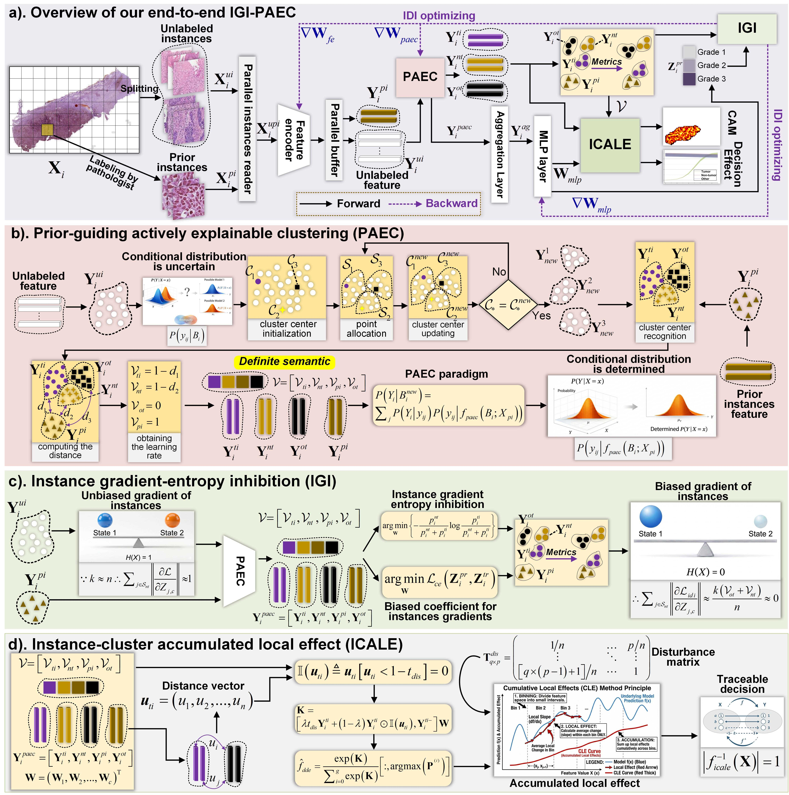
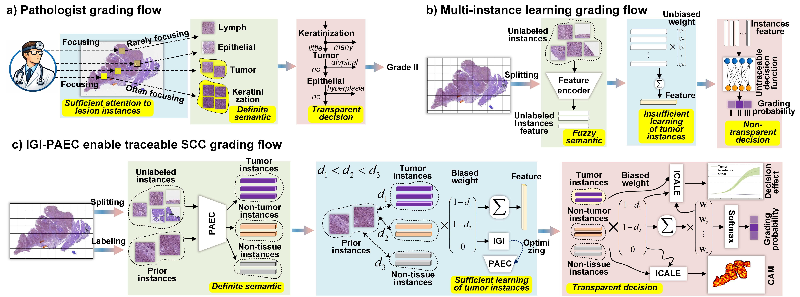

# IGI-PAEC: Interpretable WSI Grading with Prior-Guiding Actively Explainable Clustering

[](https://www.python.org/)
[](https://pytorch.org/)
[]()

Official PyTorch implementation of **IGI-PAEC** (Instance Gradient-entropy Inhibition-optimized Prior-guiding Actively Explainable Clustering), a multiple-instance learning framework for interpretable pathological grading from whole-slide images (WSIs).

IGI-PAEC couples a patch-level visual encoder with prior-guided clustering and instance gradient-entropy inhibition. It is designed to improve both grading performance and the transparency of the WSI-level decision process.

<p align="center">
  
</p>

## Highlights

- **Prior-guiding actively explainable clustering** for grouping diagnostically meaningful WSI instances.
- **Instance gradient-entropy inhibition** for suppressing uninformative or unstable evidence during aggregation.
- **Instance-cluster accumulated local effects** to connect model predictions with cluster-level pathological evidence.
- Reproducible training entry points for **AMU-CSCC**, **AMU-LSCC**, and **DHMC-Kidney**, plus implementations of commonly used MIL baselines.

<p align="center">
  
</p>

## Repository layout

| Path | Description |
| --- | --- |
| `IGI_PAEC_main_AMU_CSCC.py` | IGI-PAEC training, testing, and visualization entry point for AMU-CSCC. |
| `IGI_PAEC_main_AMU_LSCC.py` | IGI-PAEC entry point for AMU-LSCC. |
| `IGI_PAEC_main_DHMC_Kidney.py` | IGI-PAEC entry point for DHMC-Kidney. |
| `Models/IGI_PAEC_model_modules.py` | Feature extractor, IGI-PAEC head, and ablation modules. |
| `Utils/training_testing_for_IGI_PAEC.py` | Training loop, evaluation, reproducibility utilities, and learning-rate schedules. |
| `Utils/Read_MIL_Datasets.py` | Patch-bag dataset reader for image-based MIL experiments. |
| `Main_func_SOTAs/` | Implementations of baseline MIL methods. |
| `Main_func_SOTAs_AMU/` | Baseline implementations configured for the AMU experiments. |
| `Training_Testing_for_SOTA/` | Training and testing routines for baseline methods. |
| `Results_codes/` | Feature, layer, relation, and local-effect analysis utilities. |
| `WSI_Processing/` | Whole-slide image preparation utilities. |

## Environment

IGI-PAEC was developed with Python 3.8--3.10, PyTorch 1.11.0, and CUDA-enabled NVIDIA GPUs. Create an isolated environment and install the portable core dependencies:

```bash
git clone https://github.com/Baron-Huang/IGI-PAEC.git
cd IGI-PAEC

conda create -n igi-paec python=3.9 -y
conda activate igi-paec

# Install the PyTorch build matching your CUDA version first.
pip install torch==1.11.0 torchvision==0.12.0 torchaudio==0.11.0
pip install -r requirements.txt
```

The core IGI-PAEC pipeline does not require PyTorch Geometric. Some baseline models do. For those models, install the matching `torch-geometric` packages following the [official PyG installation guide](https://pytorch-geometric.readthedocs.io/en/latest/install/installation.html).

> **Note:** `Models/SwinT_models/` includes the Swin Transformer source used by the project. The precompiled Windows extension and local build caches are intentionally excluded. The released IGI-PAEC entry points use `fused_window_process=False`, so this extension is not required for the standard workflow.

## Data preparation

The image-based MIL reader expects each WSI bag to be a directory of image patches. Class labels are assigned according to the natural sort order of the class-directory names. Use a numeric directory name such as `0`, `1`, and `2` to make the label mapping explicit.

```text
DATA_ROOT/
├── train/
│   ├── 0/
│   │   ├── case_001/
│   │   │   ├── patch_0001.png
│   │   │   └── ...
│   │   └── ...
│   ├── 1/
│   └── 2/
├── val/
│   ├── 0/
│   ├── 1/
│   └── 2/
└── test/
    ├── 0/
    ├── 1/
    └── 2/
```

Before running an experiment, obtain a compatible Swin-Tiny ImageNet-22K checkpoint and provide its local path through `--pretrained_weights_path`. Dataset images, patient information, pretrained checkpoints, and experiment outputs are not distributed in this repository.

## Training

All entry scripts expose command-line options for data paths, output paths, model checkpoints, and the experimental mode. Create the output directory first, then provide your own paths rather than relying on the development-machine defaults embedded in the scripts.

Example: train IGI-PAEC on a three-class dataset:

```bash
mkdir -p outputs/amu_cscc

python IGI_PAEC_main_AMU_CSCC.py \
  --run_mode train \
  --class_num 3 \
  --train_read_path /path/to/DATA_ROOT/train \
  --val_read_path /path/to/DATA_ROOT/val \
  --test_read_path /path/to/DATA_ROOT/test \
  --pretrained_weights_path /path/to/swin_tiny_patch4_window7_224_22k.pth \
  --weights_save_feature outputs/amu_cscc/igi_paec_feature.pth \
  --weights_save_head outputs/amu_cscc/igi_paec_head.pth \
  --resu_text_path outputs/amu_cscc/train.log \
  --roc_save_path outputs/amu_cscc/roc.xlsx
```

Use `IGI_PAEC_main_AMU_LSCC.py` or `IGI_PAEC_main_DHMC_Kidney.py` for the corresponding cohort. The scripts call CUDA directly and are intended for an NVIDIA-GPU environment.

### Evaluation and interpretation

For evaluation, set `--run_mode test` and supply the saved feature and head checkpoints:

```bash
python IGI_PAEC_main_AMU_CSCC.py \
  --run_mode test \
  --class_num 3 \
  --train_read_path /path/to/DATA_ROOT/train \
  --val_read_path /path/to/DATA_ROOT/val \
  --test_read_path /path/to/DATA_ROOT/test \
  --pretrained_weights_path /path/to/swin_tiny_patch4_window7_224_22k.pth \
  --test_weights_feature outputs/amu_cscc/igi_paec_feature.pth \
  --test_weights_head outputs/amu_cscc/igi_paec_head.pth \
  --roc_save_path outputs/amu_cscc/roc.xlsx
```

Set `--run_mode visual` to export intermediate feature, layer, and relation outputs. Configure `--feats_save_path`, `--layers_save_path`, and `--relations_save_path` to writable directories.

## Reproducibility settings

The released experiments use the same bag-level protocol for IGI-PAEC and baseline comparisons:

| Setting | Value |
| --- | --- |
| Optimizer | AdamW |
| Loss | Cross-entropy |
| Batch size | 1 WSI bag |
| Epochs | 100 |
| Data-loader workers | 16 |
| Random seed | 1 |
| Patch size | 96 × 96 |
| Maximum patches per bag | 2,000 |
| Feature-extraction chunk | 500 patches |

The AMU-CSCC configuration uses a learning rate of $1 \times 10^{-5}$ for epochs 1--50, $5 \times 10^{-6}$ for epochs 51--75, and $1 \times 10^{-6}$ thereafter. AMU-LSCC and DHMC-Kidney use $1 \times 10^{-4}$ for epochs 1--80, $1 \times 10^{-5}$ for epochs 81--90, and $1 \times 10^{-6}$ for epochs 91--100. Data splits and evaluation procedures should be kept identical across compared methods.

## Baselines

The repository includes code paths for ABMIL, CLAM, DTFD-MIL, FRMIL, TransMIL, ILRA-MIL, RRTMIL, S4MIL, HAG-MIL, and DGR-MIL. The baseline entry points are under `Main_func_SOTAs/`; their shared training and evaluation routines are under `Training_Testing_for_SOTA/`. Use the same split definition, WSI patching process, number of classes, and evaluation protocol as IGI-PAEC for fair comparison.

## Notes

- The code assumes a patch-level WSI workflow. Use `WSI_Processing/` and the feature-extraction utilities to adapt raw WSIs to your storage convention.
- The provided image reader loads all patches from a bag directory and centrally samples when a bag exceeds `--bags_len`.
- Please comply with your institution's ethics requirements and all dataset access agreements before processing or sharing pathology data.

## Contact

For questions about the implementation, please open a GitHub issue in this repository.
